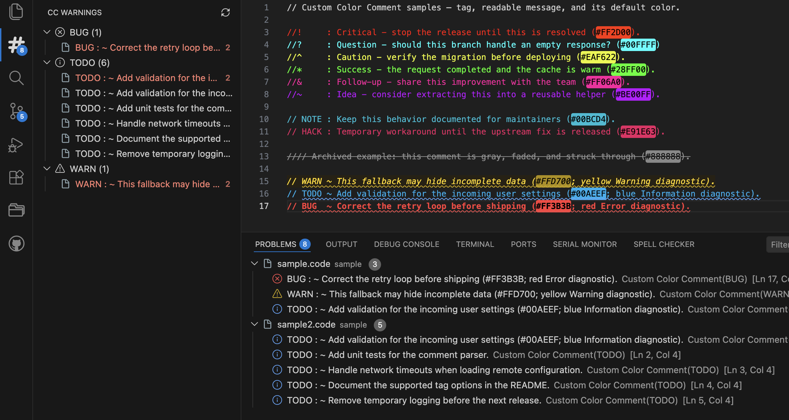

# Custom Color Comment

[](https://marketplace.visualstudio.com/items?itemName=kmmhanan.custom-color-comment)
[](./LICENSE)

**[Install from the VS Code Marketplace →](https://marketplace.visualstudio.com/items?itemName=kmmhanan.custom-color-comment)**

Color comments based on a tag right after the comment marker — inspired by
**Colorful Comments**, rebuilt to be fully customizable from `settings.json`
and to work across virtually any language, not just `//`.



---

## ✨ Features

- 🏷️ **Tag-based coloring** — `//! red`, `//? cyan`, `// TODO: blue`, `//// grayed-out strikethrough`
- 🌍 **Any language** — Python's `#`, Lua's `--`, HTML's `<!-- -->`, block comments `/* */`, and more
- 🎨 **Fully customizable** — text/background color and opacity, bold, italic, line-through, and colored wavy underlines
- ⚡ **Sensible defaults** out of the box, override or extend anything via `settings.json`

---

## 📦 Installation

Search **"Custom Color Comment"** in the VS Code Extensions view, or install
directly from the [Marketplace](https://marketplace.visualstudio.com/items?itemName=kmmhanan.custom-color-comment).

---

## 🚀 Usage

Write a tag right after your comment marker:

```js
//! Test red color
//? What about this branch?
// TODO: refactor this later
//// this whole block is disabled
```

```python
#! also works here
```

---

## 🎨 Default Tags

| Tag    | Style                                          |
| ------ | ---------------------------------------------- |
| `!`    | red (`#FF2D00`)                                |
| `?`    | cyan (`#00FFFF`)                               |
| `^`    | yellow (`#EAF622`)                             |
| `*`    | green (`#28FF00`)                              |
| `&`    | pink (`#FF06A0`)                               |
| `~`    | purple (`#BE00FF`)                             |
| `////` | gray, line-through, 90% opacity                |
| `TODO` | blue (`#00AEEF`), Information diagnostic       |
| `NOTE` | cyan (`#00BCD4`)                               |
| `HACK` | pink (`#E91E63`)                               |
| `WARN` | yellow, background, italic, Warning diagnostic |
| `BUG`  | red, bold, Error diagnostic                    |

> Plain, untagged `//` comments are left at your theme's normal comment
> color by default — nothing greys them out unless you configure it.

---

## ⚙️ Custom Colors — `settings.json`

```json
"ccComment.tags": {
  "!": "#FF0000",
  "?": "#00FFFF",
  "////": { "color": "#999999", "lineThrough": true, "opacity": 0.9 },
  "TODO": { "color": "#00AEEF", "error": true, "errorColor": "blue", "errorWarning": true },
  "WARN": {
    "color": "#FFD700",
    "backgroundColor": "#332200",
    "backgroundOpacity": 0.4,
    "italic": true,
    "error": true,
    "errorColor": "yellow",
    "errorWarning": true
  },
  "BUG": { "color": "#FF3B3B", "bold": true, "error": true, "errorColor": "red", "errorWarning": true }
},
"ccComment.ignoreWarning": [],
"ccComment.ignoreAggressive": ["ios/**", "macos/**"],
"ccComment.showSideBarCount": true,
"ccComment.showInProblems": true
```

The **CC Warnings** activity bar icon shows the total number of diagnostics
created by this extension. Set `"ccComment.showSideBarCount": false` to hide the
badge. Set `"ccComment.showInProblems": false` to keep these diagnostics in the
CC Warnings sidebar while hiding them from VS Code's Problems panel. Other
extensions' and tools' problems are unaffected.

Each value is either a plain hex string, or an object with any of:

| Property            | Type    | Effect                                                                                           |
| ------------------- | ------- | ------------------------------------------------------------------------------------------------ |
| `color`             | string  | text color (hex)                                                                                 |
| `backgroundColor`   | string  | background color (hex)                                                                           |
| `backgroundOpacity` | number  | background transparency, `0`–`1` (requires `backgroundColor`)                                    |
| `bold`              | boolean | bold text                                                                                        |
| `italic`            | boolean | italic text                                                                                      |
| `lineThrough`       | boolean | strikethrough                                                                                    |
| `opacity`           | number  | `0`–`1`, fades the text                                                                          |
| `error`             | boolean | enable diagnostics for this tag                                                                  |
| `errorColor`        | string  | `"blue"` = Information, `"yellow"` = Warning, `"red"` = Error                                    |
| `errorWarning`      | boolean | create a native VS Code diagnostic; shown in Problems when `ccComment.showInProblems` is enabled |

### Controlling which paths are checked

Both path settings accept workspace-relative glob patterns. In a Flutter
workspace, for example:

```json
"ccComment.ignoreWarning": ["ios/**"]
```

This suppresses comment diagnostics for files under `ios` (like the
`ccComment:disable-errors` directive), while keeping comment colors active.

```json
"ccComment.ignoreAggressive": ["generated/**"]
```

This keeps those paths out of background workspace scans, including startup and
file-created rescans. Their diagnostics are checked while a file is open and
cleared when it closes. An empty array leaves all paths enabled. These settings
can be used independently or together.

The extension also detects common project manifests and automatically skips
generated/dependency folders for that project type. For example, Flutter
projects skip their native platform scaffolding and Dart build data, Python
projects skip caches and virtual environments, and Rust projects skip `target`.
These folder names are scoped to detected projects, so a directory such as
`ios` in an unrelated project is still scanned. Use
`ccComment.ignoreAggressive` for additional project-specific paths.

Set both `error: true` and `errorWarning: true` to create a VS Code diagnostic.
The whole comment text (starting at the tag, without leading whitespace) is
the diagnostic range. VS Code supplies the native squiggle and its severity
color; the extension does not draw a styled underline. Since native squiggles
come from diagnostics, they are also listed in the **Problems** panel. To
suppress these diagnostics for a single file, put this directive on its first
line using that language's comment syntax:

```js
// ccComment:disable-errors
```

For example, use `# ccComment:disable-errors` in Python and
`<!-- ccComment:disable-errors -->` in HTML. This only suppresses diagnostics
in that file; comment colors and other styles remain active.

The extension scans supported source files across the workspace when it
starts, including files that are not currently open, except paths configured in
`ccComment.ignoreAggressive`. To run the scan again, click **$(refresh)
Warnings** in the status bar, use the refresh button on the **CC Warnings**
sidebar, or run **ccComment: Refresh Warnings** from the Command Palette. The
sidebar groups diagnostics by configured tag in severity order (red errors,
blue information, then yellow warnings); selecting an entry opens the file at
that comment. Creating or deleting supported files triggers a rescan, so
removed files no longer leave stale warning counts. Git diff documents are
ignored to avoid reporting the same file twice. The scan and automatic
file-created rescans skip common build folders and project-type-specific
generated or dependency folders, so build output does not repeatedly trigger
workspace scans. Deleted files have their diagnostics removed directly without
rescanning the workspace.

- Your entries merge on top of the defaults (yours win on conflicts). Set
  `"ccComment.disableDefaultTags": true` to use only your own tags.
- Letter tags (like `TODO`) match as a whole word, so `TODOING` won't
  falsely trigger.
- Symbol tags (`!`, `?`, `*`) match right after the comment marker, with or
  without a space: `//!` and `// !` both work.
- Tags that repeat the comment marker itself (like `////`) are matched from
  the true start of the comment, so a 4-slash line is only caught by `////`,
  not accidentally by a 2- or 3-slash rule.

---

## 📜 License

MIT © [Kmm Hanan](https://kmmhanan.com) — see [LICENSE](./LICENSE).
